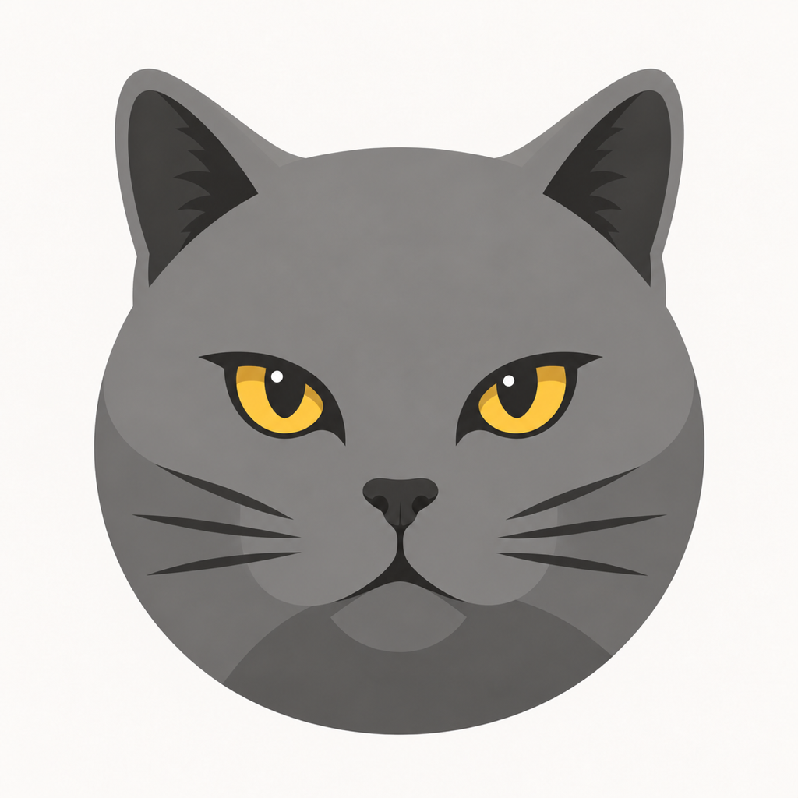
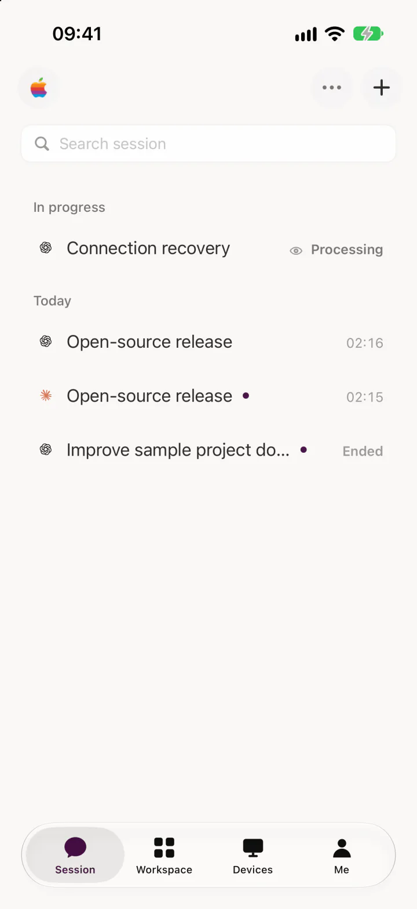
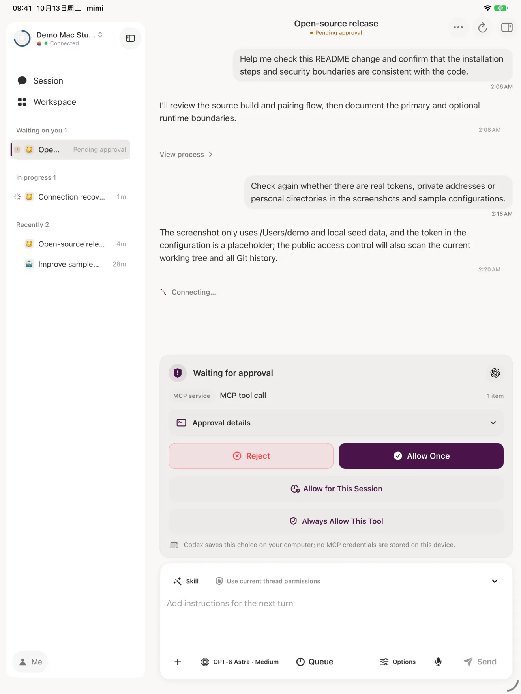
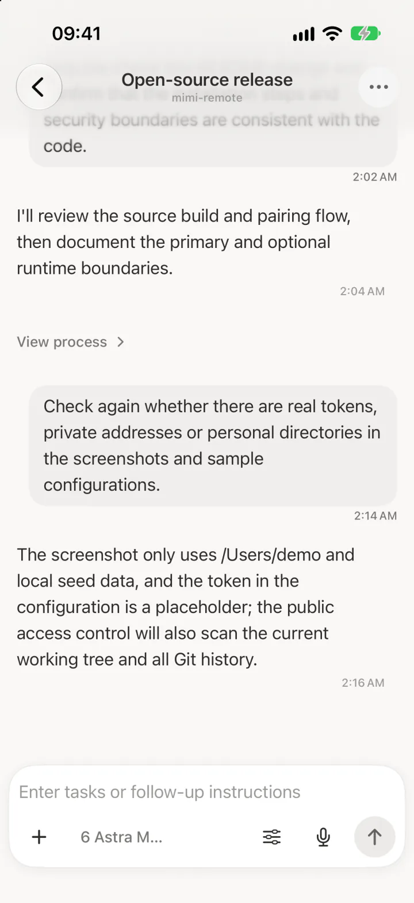
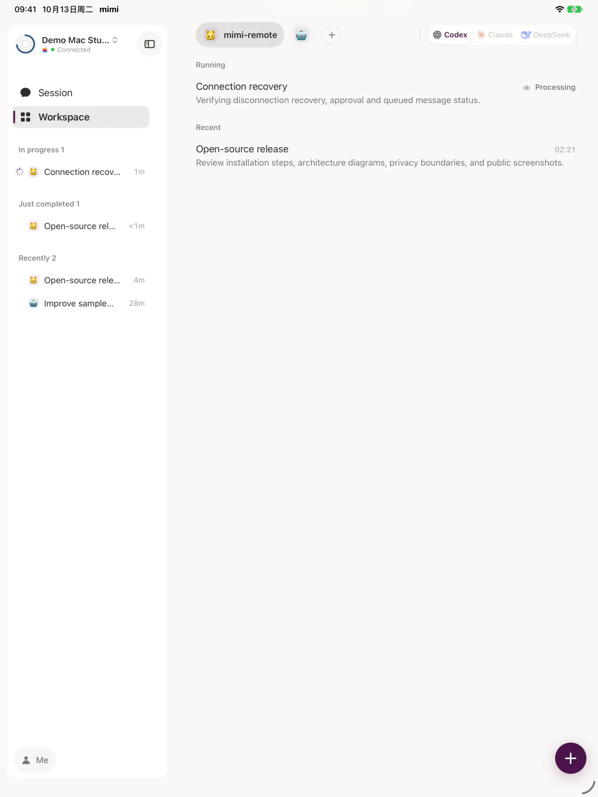
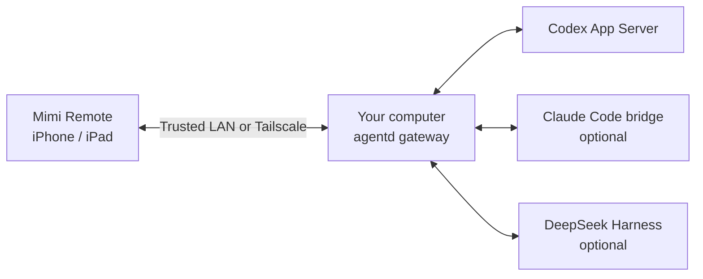

<h1 align="center">Mimi Remote</h1>

<strong>Remote control for Codex and Claude Code.</strong>

Your Mac, Windows, or Linux computer keeps running the agent. From your iPhone or iPad, you watch the progress, reply, and approve. Free, open source, no cloud account.

<a href="README.zh-CN.md">简体中文</a> · <a href="https://remote.code89757.com/">Website</a> · <a href="https://apps.apple.com/us/app/mimi-remote/id6778076511">App Store</a> · <a href="https://testflight.apple.com/join/jhGPbSk6">TestFlight</a> · <a href="https://github.com/gaixianggeng/mimi-remote/releases/latest">Desktop downloads</a>

 &nbsp;&nbsp; 

Codex, Claude Code, your projects, and your sessions all stay on your own computer. Mimi Remote connects to it over a trusted local network or Tailscale and turns the conversation, tool steps, approvals, and changes into a native iPhone and iPad interface. Mimi Remote is an independent project, unaffiliated with OpenAI, Anthropic, DeepSeek, or Tailscale.

## What you can do

- **Watch it work:** follow live replies, tool steps, and task status. Pick up a session you started on your computer without re-explaining the project.
- **Step in anytime:** answer the agent's questions, approve or reject the commands it wants to run, queue the next instruction, or interrupt a running turn. When it needs you, a notification reaches your lock screen.
- **Finish the work:** with Codex, review changes and use Worktree and Git actions from the app.
- **One phone, several computers:** pair several computers, each with its own credentials, and pick the active one in **Devices**. Sessions stay on the computer that owns them.
- **One app, several agents:** control both Codex and Claude Code, and optionally DeepSeek Harness. See [Runtimes](#runtimes) for what each one supports.
- **Use either screen:** a compact view on iPhone, a multi-column workspace on iPad.

 &nbsp;&nbsp; 

Screenshots show the English interface with sample data. The app is also available in Simplified Chinese.

## How it differs from remote desktop and SSH

| | Remote desktop | SSH + tmux | Mimi Remote |
| --- | --- | --- | --- |
| What you see on the phone | Your whole desktop, zoomed in to read | Terminal text | Conversation, tool steps, approvals, and changes laid out for the phone |
| How you reply and approve | Click and type on a tiny screen | Type and press keys in a terminal | A composer and buttons |
| When the agent needs you | No alert | Needs extra setup | A lock-screen notification |
| First connection | Install remote-control software and sign in | Enable SSH, set up keys, install tmux | Install Mimi Remote on the computer, scan a QR code |

Mimi Remote controls agent sessions only. To operate the whole computer or an arbitrary shell from your phone, a remote desktop or SSH client is the better fit.

## Get started

You need an iPhone or iPad on **iOS/iPadOS 18+** and a computer that stays awake while you connect: **macOS 15+**, **Windows 10/11 x64**, or **Linux** (x86_64 or ARM64 with a systemd user session).

1. Install and sign in to the [Codex CLI](https://learn.chatgpt.com/docs/codex/cli) on that computer. On a Mac, the ChatGPT desktop app also works.
2. Install the host from [Releases](https://github.com/gaixianggeng/mimi-remote/releases/latest): `Mimi-Remote-Mac.dmg` on Mac, the `Mimi-Remote-Setup` installer on Windows, or the `linux` archive on Linux. On a Mac, drag **Mimi Remote Mac** to Applications and open it; a setup window asks for your code folder and then shows a pairing QR code. The [installation guide](docs/install-upgrade-rollback.md) covers checksums, first-run setup, upgrades, and rollback.
3. Install the app from the [App Store](https://apps.apple.com/us/app/mimi-remote/id6778076511) where available, join [TestFlight](https://testflight.apple.com/join/jhGPbSk6), or [build it from source](ios/MimiRemote/README.md). On the home screen it is called **mimi**.
4. Scan the QR code in the app. To show it again later, click the Mimi Remote icon in the Mac menu bar (or the Windows notification area) and choose the pairing item. If you can't scan, copy the pairing link from that window and paste it in the app. From a terminal, `agentd pair --qr-only` shows the code without printing the long-lived token.
5. Pick a project. After connecting, the app lists the projects in your code folder; tap one to open it as a workspace and start a session.

To add another computer, repeat these steps on it. To let Codex install, upgrade, or diagnose the host for you, use the [install-mimi-remote Skill](packaging/skill/install-mimi-remote).

## Runtimes

| Runtime | On mobile | Setup |
| --- | --- | --- |
| **Codex** | Main runtime: sessions, live progress, approvals, task controls, and project tools. | Install and sign in to Codex CLI. |
| **Claude Code** (experimental) | Sessions and approvals, with fewer controls than Codex. No goals, archive, or fork. | Install and sign in to Claude Code. Mimi Remote Mac and the Windows installer include the Claude adapter; the Mac app turns it on once Claude Code is signed in, and other hosts turn it on manually. Linux and Homebrew hosts install the legacy bridge separately ([Skill steps](packaging/skill/install-mimi-remote/SKILL.md)). |
| **DeepSeek Harness** | Text sessions and live progress. No attachments, Skills, plans, goals, or archive. | Run Harness on the host, then connect it from Mimi Remote Mac. Harness manages its own execution permissions. |

Technical details: [Claude adapter](bridges/claude-sdk/README.md) · [legacy Claude bridge](docs/claude-bridge-architecture.md) · [DeepSeek Harness protocol](docs/deepseek-harness-protocol.md).

## How it works

On Windows, the Codex App Server listens on a loopback WebSocket and is not exposed directly to the LAN.

`agentd` on your computer authenticates the app and routes it to the selected runtime. There is no cloud account, session hosting, or application-level relay. Message notifications are on by default; they go through a small push service that receives only the APNs device token, random identifiers and anonymous short tags for the computer and session, the runtime and event type (such as an approval request or a finished task), and an expiry, never prompts, code, or session content. See the [privacy policy](docs/privacy-policy.md). Keep `agentd` on a private network; do not expose its plain HTTP port to the public Internet.

Mac, Windows, and Linux hosts also offer an experimental Tailcat connection, off by default, that lets the app reach the host without the Tailscale app. On Windows it also works without LAN access and adds no firewall rule: turn it on from the notification-area control panel, then choose Tailcat when pairing. Every connection first contacts a DERP relay for discovery and its initial handshake, then moves end-to-end encrypted traffic to a direct path when available. Otherwise, the relay continues forwarding that traffic. The relay processes connection metadata even when traffic later moves to a direct path. The default relay is operated by Tailscale, not by Mimi Remote; you can configure your own relay on the host.

New sessions use the Full File Access permission mode by default, so agents run commands and edit files without asking each time. To confirm actions one by one, change Default permissions to Ask for Approval in the app's settings. See [SECURITY.md](SECURITY.md) for the risks.

Mimi Remote is a session client. It is not a remote shell, and it does not run agents on iOS. Sessions created in Codex Desktop's ordinary "This Mac" mode are not shared; connect Desktop through the [shared App Server](docs/shared-ssh-app-server.md) to continue them on mobile.

## FAQ

**Do I sign in to OpenAI or Anthropic on my phone?**\
No. The app only connects to the computer you paired. The agent uses the Codex or Claude Code sign-in already on that computer, and Mimi Remote never handles those credentials.

**Does my computer need to stay on?**\
Yes. The agent runs on the computer, so it has to stay awake and online while you connect.

**Where are my sessions stored?**\
On your computer, by Codex, Claude Code, or DeepSeek Harness. Mimi Remote has no cloud account and does not host sessions.

**How do I connect when I'm not on the same network?**\
Put your phone and computer on the same private network with Tailscale. Mac, Windows, and Linux computers can also try the experimental Tailcat connection described in [How it works](#how-it-works).

**Does it cost anything?**\
The iPhone and iPad app and the computer software are free and open source, with no in-app purchases or subscriptions. Model usage counts against the Codex or Claude Code account on your computer.

**How is this different from the official mobile remote features from OpenAI and Anthropic?**\
Each official feature serves its own agent. Mimi Remote connects to both Codex and Claude Code (and DeepSeek Harness) in one app, works with Mac, Windows, and Linux computers and switches between several of them, gives you a multi-column workspace on iPad, and is fully open source. The official features change quickly, so pick whatever fits the tools and accounts you use.

## Contributing

This repository contains the SwiftUI iPhone/iPad app, the Go `agentd` host, the Mac menu bar app, the Windows and Linux tray, and the Claude bridge. Start with [CONTRIBUTING.md](CONTRIBUTING.md) for checks and conventions, and the [iOS build guide](ios/MimiRemote/README.md) for the app. Maintainers run `bash ./scripts/verify-release.sh` before a formal release.

Report bugs and ideas in [GitHub Issues](https://github.com/gaixianggeng/mimi-remote/issues/new). Report vulnerabilities privately through [SECURITY.md](SECURITY.md). For help, see the [support page](docs/support.md).

## License

Mimi Remote's own code and documentation use [GPLv3 with an additional store-distribution permission](LICENSE). The [Claude bridge](bridges/claude/LICENSE) is GPLv3-only. Third-party notices are in [NOTICE.md](NOTICE.md) and [THIRD_PARTY_NOTICES.md](THIRD_PARTY_NOTICES.md). The license does not cover the Mimi Remote name or icons; see the [trademark policy](TRADEMARKS.md) and [terms of use](docs/terms-of-use.md).
