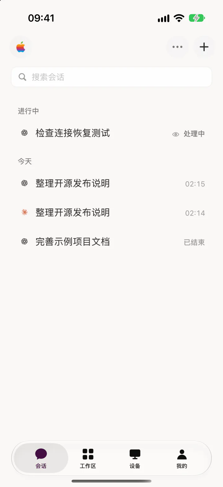
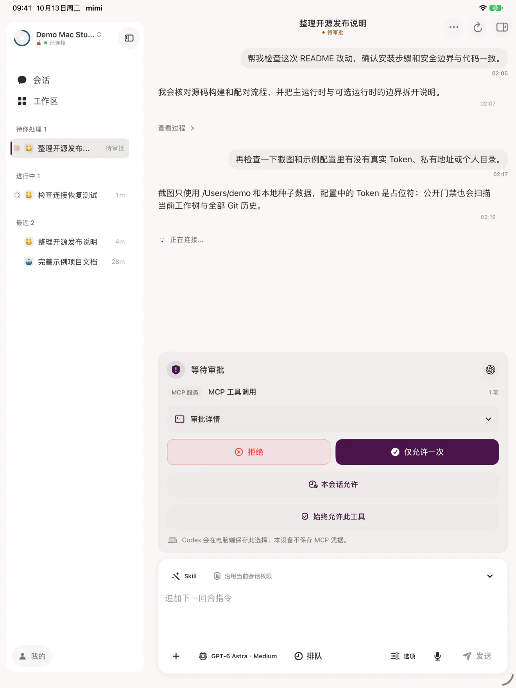
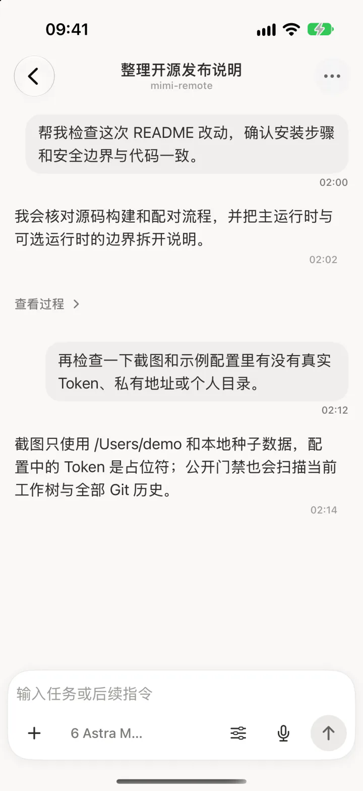
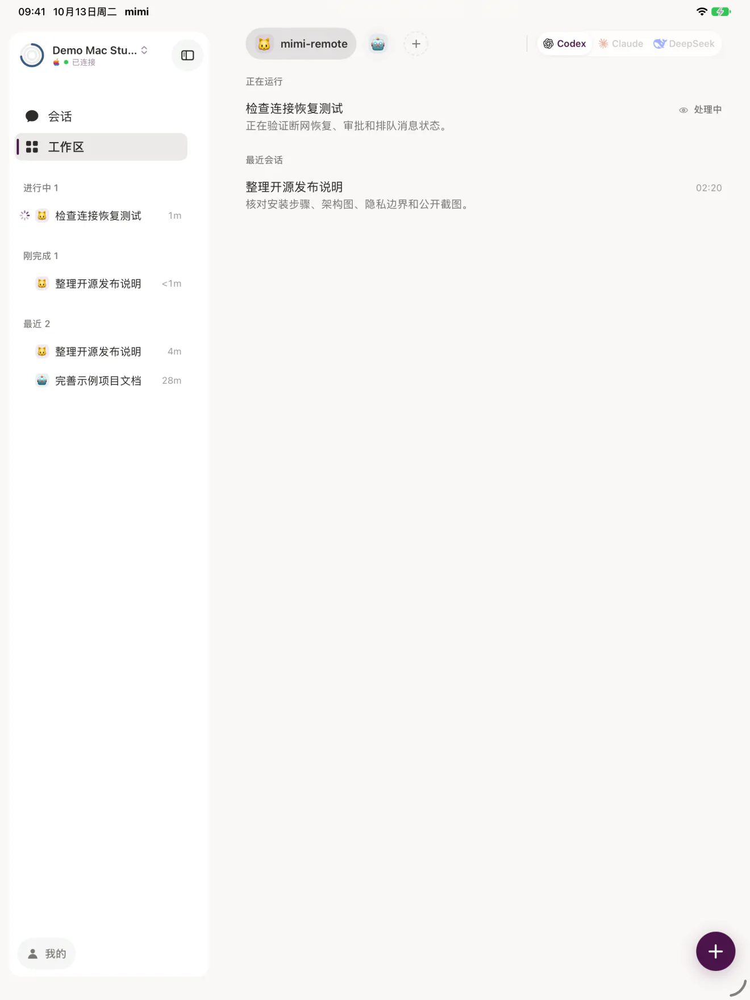
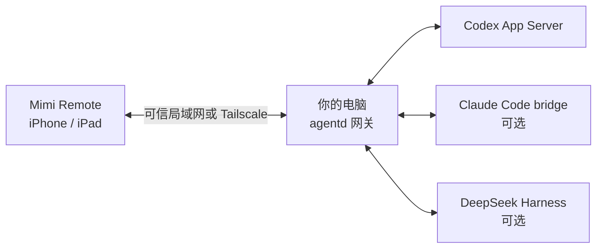

<h1 align="center">Mimi Remote</h1>

<strong>用手机，遥控电脑上的 Codex 和 Claude Code。</strong>

Agent 继续在你的 Mac、Windows 或 Linux 电脑上干活，你在 iPhone、iPad 上看进度、回消息、批权限。开源免费，没有云账号。

<a href="README.md">English</a> · <a href="https://remote.code89757.com/?lang=zh">官网</a> · <a href="https://apps.apple.com/us/app/mimi-remote/id6778076511">App Store</a> · <a href="https://testflight.apple.com/join/jhGPbSk6">TestFlight</a> · <a href="https://github.com/gaixianggeng/mimi-remote/releases/latest">电脑端安装包</a>

 &nbsp;&nbsp; 

Codex、Claude Code 和你的项目、会话都留在自己的电脑上运行。Mimi Remote 通过可信局域网或 Tailscale 连到这台电脑，把对话、工具步骤、审批和改动做成适合手机和 iPad 的原生界面。这是独立第三方项目，与 OpenAI、Anthropic、DeepSeek 和 Tailscale 没有隶属或背书关系。

## 能做什么

- **看它干活：**实时看回复、工具步骤和任务状态。电脑上开的会话在手机上接着聊，不用重新交代项目背景。
- **随时插手：**回答 Agent 的提问，批准或拒绝它要运行的命令，排好下一条指令，或者直接中断正在跑的任务。需要你处理时，通知会推到锁屏。
- **把活干完：**使用 Codex 时可以看改动，并在 App 里用 Worktree 和 Git 收尾。
- **一部手机管几台电脑：**配对多台电脑，每台使用独立凭据，在「设备」里切换当前连接。会话仍属于各自的电脑。
- **一个 App 用多个 Agent：**Codex 和 Claude Code 都能遥控，还可以接入 DeepSeek Harness。各自支持的操作见[运行时](#运行时)。
- **两种屏幕都顺手：**iPhone 是紧凑的会话界面，iPad 是多栏工作台。

 &nbsp;&nbsp; 

截图使用示例数据，不含真实工作区内容或凭据。App 同时支持简体中文和英文。

## 和远程桌面、SSH 终端有什么不同

| | 远程桌面 | SSH + tmux | Mimi Remote |
| --- | --- | --- | --- |
| 手机上看到什么 | 整个电脑屏幕，要放大才看得清 | 终端里的字符 | 为手机排版的对话、工具步骤、审批和改动 |
| 怎么回复和审批 | 在小屏幕上点鼠标、打字 | 在终端里打字、按键 | 输入框和按钮 |
| Agent 需要你时 | 没有提醒 | 要另外配置 | 推送到锁屏 |
| 第一次怎么连 | 装远程控制软件并登录 | 开 SSH、配密钥、装 tmux | 电脑上装 Mimi Remote，手机扫码 |

Mimi Remote 只遥控 Agent 会话。要在手机上操作整台电脑或任意命令行，远程桌面和 SSH 终端更合适。

## 快速开始

你需要一台 **iOS / iPadOS 18+** 的 iPhone 或 iPad，以及一台连接期间保持唤醒的电脑：**macOS 15+**、**Windows 10/11 x64**，或 **Linux**（x86_64 或 ARM64，需要 systemd 用户会话）。

1. 在这台电脑上安装并登录 [Codex CLI](https://learn.chatgpt.com/docs/codex/cli)。Mac 上用 ChatGPT 桌面版也可以。
2. 从 [Releases](https://github.com/gaixianggeng/mimi-remote/releases/latest) 安装宿主：Mac 用 `Mimi-Remote-Mac.dmg`，Windows 用 `Mimi-Remote-Setup` 安装程序，Linux 用 `linux` 归档。Mac 上把 **Mimi Remote Mac** 拖进「应用程序」后打开，首次设置窗口会让你选代码文件夹，完成后直接显示配对二维码。校验、首次配置、升级和回滚见[安装文档](docs/install-upgrade-rollback.md)。
3. 在已上架地区从 [App Store](https://apps.apple.com/us/app/mimi-remote/id6778076511) 安装 App，或加入 [TestFlight](https://testflight.apple.com/join/jhGPbSk6)，也可以[从源码构建](ios/MimiRemote/README.md)。App 在主屏上叫 **mimi**。
4. 用 App 扫描二维码。以后要再次显示，点 Mac 菜单栏（Windows 任务栏右下角）的 Mimi Remote 图标，选「配对设备…」。扫不了码时，在配对窗口点「复制配对链接」，再到 App 里粘贴。在终端里运行 `agentd pair --qr-only` 也能显示二维码，且不会打印长期访问码。
5. 选一个项目。连上之后，App 会列出代码文件夹里的项目，点一下就打开为工作区，然后新建会话。

要添加另一台电脑，在那台电脑上重复以上步骤。想让 Codex 代你安装、升级或排查宿主，可以使用 [install-mimi-remote Skill](packaging/skill/install-mimi-remote)。

## 运行时

| 运行时 | 移动端能力 | 配置 |
| --- | --- | --- |
| **Codex** | 主运行时：会话、实时进度、审批、任务控制和项目工具。 | 安装并登录 Codex CLI。 |
| **Claude Code**（实验） | 会话与审批，控制项少于 Codex；不支持目标、归档和 fork。 | 安装并登录 Claude Code。Mimi Remote Mac 与 Windows 安装包已内置 Claude 适配器：Mac App 检测到 Claude Code 已登录后自动开启，其他宿主需手动开启；Linux 和 Homebrew 宿主需单独安装旧 bridge（[Skill 步骤](packaging/skill/install-mimi-remote/SKILL.md)）。 |
| **DeepSeek Harness** | 文本会话与实时进度；不支持附件、Skills、计划、目标和归档。 | 在宿主上运行 Harness，再从 Mimi Remote Mac 连接。执行权限由 Harness 自己管理。 |

技术细节：[Claude 适配器](bridges/claude-sdk/README.md) · [旧 Claude bridge](docs/claude-bridge-architecture.md) · [DeepSeek Harness 接入协议](docs/deepseek-harness-protocol.md)。

## 工作原理

Windows 上的 Codex App Server 只监听本机 loopback WebSocket，不向局域网直接开放。电脑通过不需要认证的 Windows 系统代理（例如本机代理软件）上网时，Mimi Remote 启动的 Codex 与 Claude 会自动使用它；代理软件开关后也随之生效。本机中转不支持需要 407 认证挑战的上游代理，包括 NTLM 和 Negotiate；这类环境应在 `codex.env` 或 `claude.env` 中配置可直接使用的代理。

电脑上的 `agentd` 负责验证 App 的连接，并转到所选运行时。没有云账号、会话托管或应用层中转。消息通知默认开启，经由一个小型推送服务发送；它只接收 APNs 设备 Token、随机编号与电脑和会话的匿名短标签、运行时与事件类型（如待审批、任务完成）和过期时间，不接收提示词、代码或会话内容，详见[隐私政策](docs/privacy-policy.md)。`agentd` 只应在私有网络中访问，不要把它的明文 HTTP 端口暴露到公网。

Mac、Windows 与 Linux 宿主还提供实验性 Tailcat 连接（默认关闭），开启后手机无需安装 Tailscale 也能连到宿主。Windows 上也不需要开启局域网，不新增防火墙规则：在任务栏托盘的控制面板中开启 Tailcat，配对时选择 Tailcat 即可。每次连接都会先通过 DERP 中继发现对端并完成初始握手，随后在网络允许时将端到端加密的流量切换为直连；无法直连时继续经中继转发。即使随后直连，中继也会处理建立连接所需的网络元数据。默认中继由 Tailscale 运营，不由 Mimi Remote 运营，也可以在宿主上改为自建中继。

新会话默认使用「完全文件访问」权限档位，Agent 执行命令和修改文件时不会逐条询问。需要逐条确认时，在 App 设置的「默认权限」中改为「请求审批」。风险说明见 [SECURITY.md](SECURITY.md)。

Mimi Remote 是会话客户端，不是远程 Shell，也不在 iOS 上运行 Agent。Codex Desktop 普通「This Mac」模式里的会话不会共享；要在移动端接着用，请按[共享 App Server](docs/shared-ssh-app-server.md) 接入 Desktop。

## 常见问题

**手机要登录 OpenAI 或 Anthropic 账号吗？**\
不用。App 只连接你配对的电脑，Agent 使用电脑上已经登录的 Codex 或 Claude Code，Mimi Remote 不接触这些凭据。

**电脑要一直开着吗？**\
要。Agent 在电脑上运行，连接期间电脑需要保持唤醒和联网。

**会话保存在哪里？**\
在你的电脑上，由 Codex、Claude Code 或 DeepSeek Harness 自己保存。Mimi Remote 没有云账号，也不托管会话。

**不在同一个网络时怎么连？**\
用 Tailscale 让手机和电脑处在同一个私有网络。Mac、Windows 与 Linux 电脑也可以试用实验性的 Tailcat 连接，说明见[工作原理](#工作原理)。

**收费吗？**\
App 和电脑端都免费、开源，没有内购和订阅。模型用量算在你电脑上 Codex 或 Claude Code 使用的账号上。

**和 OpenAI、Anthropic 官方的手机远程功能有什么不同？**\
官方功能各自服务自家的 Agent。Mimi Remote 在一个 App 里同时连接 Codex 和 Claude Code（以及 DeepSeek Harness），电脑可以是 Mac、Windows 或 Linux，能在多台之间切换，iPad 上是多栏工作台，代码全部开源。官方功能更新很快，按你使用的工具和账号选择即可。

## 参与开发

仓库包含 SwiftUI iPhone / iPad App、Go `agentd` 宿主、Mac 菜单栏 App、Windows 与 Linux 托盘，以及 Claude bridge。检查与约定见 [CONTRIBUTING.md](CONTRIBUTING.md)，App 构建见 [iOS 构建说明](ios/MimiRemote/README.md)。维护者在正式发布前运行 `bash ./scripts/verify-release.sh`。

Bug 和建议请提交 [GitHub Issue](https://github.com/gaixianggeng/mimi-remote/issues/new)，安全问题按 [SECURITY.md](SECURITY.md) 私下报告，使用帮助见[支持说明](docs/support.md)。

## 许可

Mimi Remote 自有代码与文档采用 [GPLv3，并附商店分发额外许可](LICENSE)。[Claude bridge](bridges/claude/LICENSE) 为 GPLv3-only。第三方许可见 [NOTICE.md](NOTICE.md) 和 [THIRD_PARTY_NOTICES.md](THIRD_PARTY_NOTICES.md)。代码许可不包括 Mimi Remote 名称和图标的使用权，详见[商标政策](TRADEMARKS.md)和[使用条款](docs/terms-of-use.md)。
