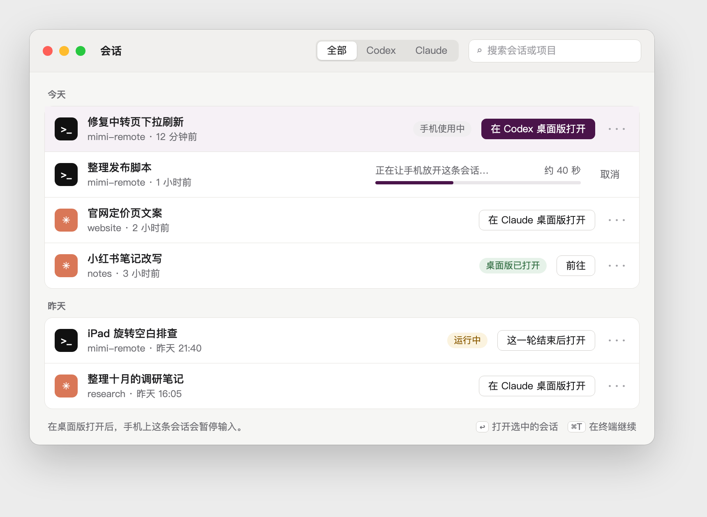

# 电脑端会话窗口与桌面版交接方案（#991）

2026-11-11 · 状态：D1–D4 已确认，第 0 步复测待安排 · 概念图：

## 1. 结论

可以做，分三步交付：

1. 电脑端 Mimi 增加「会话」窗口，Claude 会话一键在 Claude 桌面版打开，两类会话都能一键在终端继续。
2. Codex 会话一键在 Codex 桌面版打开，需要时由 Mimi 自动让手机一侧放开并显示进度。
3. 手机端复用同一套能力（#726 的入口），并引导用户把 Codex 桌面版接到共用服务。

每一步之前先用当前版本的桌面版复测一次，因为交接依赖的是桌面版的内部行为。

## 2. 已核实的事实

本机当前版本：Codex 桌面版 26.1103、Codex CLI 0.166.0、Claude 桌面版 5.1231.0、Claude Code 2.1.322。

| 事实 | 依据 |
| --- | --- |
| Codex 桌面版仍注册 `codex://threads/<id>` | 11-11 读安装包 |
| Claude 桌面版仍有「resume 深链 → 导入 CLI 会话」 | 11-11 读安装包 |
| Claude 深链导入后历史完整、可续聊，手机端变只读 | 10-15 实测，当时桌面版 2.37 |
| Claude 桌面版标题为 Untitled，除非事先写入标题 | 10-15 实测 |
| Codex 桌面版接共用服务时，深链约 1 秒打开，两端同时可用 | 11-03 实测，当时 26.1027 |
| Codex「This Mac」模式：无人占用时约 2 秒接上 | 11-03 实测 |
| Codex「This Mac」模式：Mimi 一侧还占着时，桌面版显示历史但没接上，不报错，之后也不自动重试 | 11-03 实测 |
| Mimi 一侧退订后约 60 秒释放，协议没有立即释放的方法 | 11-03 实测，2 个样本 |
| Codex 桌面版切到别的会话不释放，退出才释放 | 11-03 实测 |
| `codex resume <id> --remote <地址>` 可让终端接入共用服务 | 11-11 读命令帮助，未实跑 |
| 终端 `claude --resume` 启动后，Mimi 约 0.5 秒主动让出 | 10-12 实测 |
| #726 分支已实现「打开 Claude 桌面版」：检查空闲、占用方、安装与版本，写标题，停自己的进程，再开深链 | 11-11 读代码，未合入 |

两个桌面版的行为都没有在当前版本上重新实测。Claude 桌面版从 2.37 升到了 5.12，跨度大。

## 3. 用户看到的

**入口。** 菜单栏弹窗增加一行「会话」，点开是独立窗口。打开时光标在搜索框，输入即过滤，回车打开第一条。

**列表。** 按最后活动时间排列，分「今天 / 昨天 / 更早」。每行显示助手图标、标题、项目名和时间，内容与手机端列表一致。顶部可按 Codex / Claude 筛选。

**每行的主操作只有一个：**

| 会话状态 | 行尾显示 | 点击后 |
| --- | --- | --- |
| 空闲 | 在 Codex / Claude 桌面版打开 | 直接打开 |
| 手机使用中 | 同上，带「手机使用中」标记 | 自动放开后打开，行内显示进度，可取消 |
| 回合运行中 | 这一轮结束后打开 | 排队，结束后自动打开，可取消 |
| 桌面版已打开 | 前往 | 把桌面版切到这条会话 |
| 桌面版未安装或过旧 | 按钮不可用 | 说明原因，给下载或更新入口 |

**次要操作**放在「…」菜单：在终端继续、复制会话 ID、在访达中显示项目。

**不逐次弹确认框。** 窗口底部固定一句「在桌面版打开后，手机上这条会话会暂停输入」。只有会打断正在运行的回合时才要求选择。

**不做的：** 不在电脑端 Mimi 里显示聊天内容，不做发消息。

## 4. 交接规则

### Claude

1. 回合在跑：不交接，排队等结束。
2. 终端里的 claude 正占着：拒绝，提示在终端里继续或先退出终端里的会话。
3. 桌面版已占着：直接开深链，桌面版切到这条会话。
4. 其余情况：标题不在桌面版能读到的范围内时先写入标题，停掉 Mimi 自己的进程，开深链。

交接后手机端只读。要回到手机，在手机上点接管，或在桌面版里关掉这条会话。从手机接管桌面版占用的会话尚未实测。

### Codex

**已定（11-11 实机走查后）：不等锁，直接开深链。**

- 桌面版已接本机 SSH 主机（共用服务）：直接打开，约 1 秒，手机和桌面版同时可用。
- 没接：先提示一次，建议按「让 Codex 桌面版和手机同时使用」页配置，也可以「仍然打开」，可勾选不再提示。
- 选「仍然打开」时不管锁在谁手里。如果手机还占着，桌面版会先报错并给「重试」，手机离开这条会话约 1 分钟后重试即可。

原方案里「放开 → 等锁消失 → 开深链 → 确认」的流程不做：要让 agentd 在交接期间拒绝手机重新订阅，工程量大，而接了共用服务后完全用不上。

**怎么判断桌面版接没接共用服务。** 看本机桌面版进程下有没有连到本机（127.0.0.1、localhost 或本机名）的 ssh 子进程，只读。桌面版没运行时沿用上一次观察到的结果。

**配置页。** 三步：打开「远程登录」、允许本机免密登录（给一段可重复运行的命令）、在桌面版「设置 → 连接」添加主机名 127.0.0.1 的 SSH 连接。每步只读检测，不替用户改设置。

### 在终端继续

- Codex：在项目目录运行 `codex resume <id> --remote <共用服务地址>`。终端接入的是同一个服务，不存在占用冲突，手机和终端可以同时用。这是不改任何设置就能立刻双向使用 Codex 的唯一路径。
- Claude：在项目目录运行 `claude --resume <id>`，Mimi 自动让出。

做法是生成一个临时脚本文件交给用户选的终端打开，不需要「自动化」授权：Ghostty 与「终端」直接打开脚本；Herdr 用它自带的 `herdr-app do tab.new` 在当前空间开新标签运行脚本。只列实测过的终端，没装的不出现。

### 打开方式与多处打开

每行行尾是「打开 ▾」：左半边用上次选的 App 打开，右半边列出该会话可用的 App（对应的桌面版和装着的终端），Codex 与 Claude 各记各的选择。

同一条 Claude 会话在桌面版、终端等多处打开时，各处只在打开时读一次记录，互不同步，在旧窗口里继续发消息会让记录分叉。这是上游行为，Mimi 不做跨进程同步，只在窗口底部提示：换处继续前先关掉原来那处，回来时重新打开。

## 5. 技术方案

**总体。** 交接逻辑全部放在 agentd，电脑端 App 和手机端都只是调用方：

- 网关新增一个方法 `thread/desktop/open`，两类会话共用，带进度事件和取消。
- Claude 一侧转给适配器处理，代码从 #726 分支移植（适配器 220 行加测试 217 行，网关授权约 20 行）。
- Codex 一侧由 agentd 自己处理，新增交接状态机、交接期间的订阅拦截、桌面版模式探测。

**电脑端 App 怎么拿列表。** App 作为本机的一个普通客户端，经回环地址接入现有的会话通道，用和手机相同的列表请求。这样列表范围、授权和占用标记与手机端天然一致，不需要另写一套接口。代价是 App 里要写一个精简的通道客户端。接入凭据的取得方式、握手细节在实现时确认。

没有选「给 App 单开一组 HTTP 接口」：列表的授权和过滤规则要重写一遍，容易和手机端不一致。

**电脑端 App 的改动。**

- 新增 `Features/Sessions/`（窗口、行、搜索）和 `State/SessionsStore.swift`。`HostStore.swift` 已有 1999 行，贴着 2000 行上限，新逻辑不能放进去。
- `MimiRemoteMacApp` 增加一个 `Window`，菜单栏弹窗增加一行入口。
- 「在终端继续」在 App 内完成，不经 agentd。

**手机端。** 第 1、2 步不改。交接期间的「正在电脑上打开」复用现有占用提示，旧版手机会把拒绝订阅显示成普通的占用，不会出错。

**不碰的边界。** 只用官方深链和官方改名接口。不改会话文件，不读写桌面版私有数据，不删锁文件，不给别的进程发信号。进程和锁的检查全部只读。

## 6. 分步与验收

### 第 0 步：复测（需要你在电脑前约 20 分钟）

桌面版窗口对自动化不可见，需要你看一眼结果，并在 Codex 桌面版设置里切换一次 SSH 主机开关。只用专用测试会话，测完删除。

- Claude 5.12：深链导入、标题、手机端只读。
- Codex 26.1103：没人占、Mimi 占着、放开后三种情况下的深链结果。
- Mimi 占着时失败过一次，放开后再开一次深链能否接上。
- `codex resume --remote` 是否双向可用。
- 桌面版接共用服务时，进程特征是否稳定可辨。

任何一项与上面的事实不符，先改方案再动手。

### 第 1 步：窗口 + Claude + 终端

- 窗口能打开，列表与手机端一致，可搜索和筛选。
- Claude 会话一键在桌面版打开，标题一致，可续聊。
- 两类会话都能在终端继续。
- 桌面版未安装、过旧、回合运行中、终端占用，都有可读的结果。

### 第 2 步：Codex 桌面版

- 四种锁状态各走通一遍。
- 等待有进度、可取消，超时和「没有接上」有明确提示。
- 交接期间手机端不会把会话占回去，取消或失败后手机可继续。

### 第 3 步：手机入口与共用服务引导

- 手机端会话菜单「在电脑上继续」接到同一能力（#726）。
- 电脑端 App 增加一页检查清单，说明如何让 Codex 桌面版接入共用服务，只检测不改系统设置。

### 验证方式

- Go：交接状态机用假的锁检查器和假时钟做单元测试，覆盖超时、取消、重新订阅拦截。
- 适配器：移植 #726 的测试。
- Mac App：列表、筛选、行状态的单元测试。
- 实机：每一步用专用测试会话在本机走一遍，结果回写 #991。

## 7. 风险

- **桌面版内部行为会变。** 深链和释放时间都不是公开承诺。每次桌面版大版本更新后可能失效，需要保留一句「打不开时改用在终端继续」的退路。
- **60 秒等待。** 没有办法缩短。等待期间手机不能用这条会话。
- **Codex 单向交接。** 「This Mac」模式下回到手机要退出桌面版。
- **模式探测可能不可靠。** 已有保守退路，见第 4 节。
- **冲突时在 Codex 桌面版里发消息的后果未知。** 方案通过「确认桌面版拿到锁」避免进入这个状态。
- **手机接管 Claude 桌面版占用的会话未实测。** 第 0 步一并测。

## 8. 需要你定的

| 编号 | 问题 | 我的建议 |
| --- | --- | --- |
| D1 | Codex 需要等待时，默认怎么做 | 等待并显示进度，同时在行内提供「改在终端继续」 |
| D2 | #726 的旧分支怎么处理 | 把其中适配器和网关部分移植进第 1 步，手机入口留在 #726，第 3 步再做 |
| D3 | 第一版要不要带「在终端继续」 | 要。它是 Codex 唯一不用等、不用设置的双向路径 |
| D4 | 入口放哪 | 菜单栏弹窗一行加独立窗口。全局快捷键和弹窗内的最近会话以后再说 |
| D5 | 第 0 步什么时候做 | 你方便坐在电脑前的时候，约 20 分钟 |

**2026-11-11 维护者决定：** D1–D4 按上表建议执行。复测延后；先做不依赖复测结果的会话窗口和列表。
